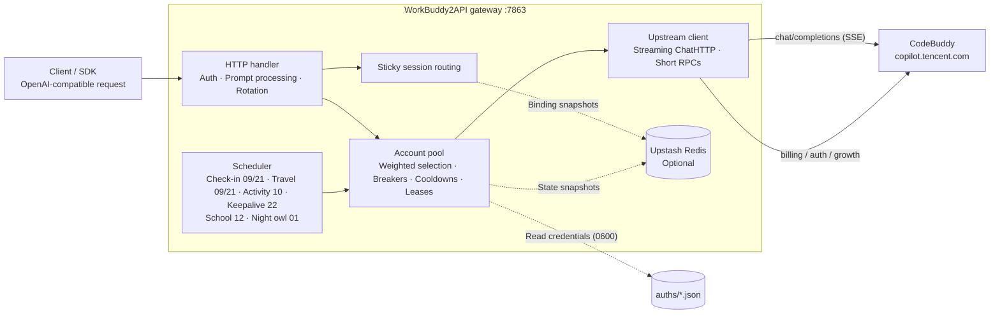

<p align="center">
  
</p>

<h1 align="center">WorkBuddy2API</h1>

<p align="center">
  <b>A multi-account gateway that turns CodeBuddy accounts into an OpenAI-compatible API</b><br>
  OAuth login · Account rotation · Circuit breakers and cooldowns · Session stickiness · Credit replenishment
</p>

<p align="center">
  
  
  
  
  <a href="https://t.me/sliverkiss_blog"></a>
</p>

---

## Overview

WorkBuddy2API is a self-hosted **OpenAI-compatible upstream gateway** that exposes CodeBuddy accounts through a unified `/v1/chat/completions` service.

### Community

- [@checkinHome](https://t.me/checkinHome)

### What it does

- Obtains account credentials through **OAuth device authorization** (`login.sh`), then handles automatic token refresh, account scheduling, and traffic management.
- Supports **multiple personal accounts**: shared capacity, automatic failover, cooldowns and circuit breakers to contain failures, and session stickiness to keep a conversation on the same account.
- Exposes an OpenAI-compatible interface that existing SDKs, frontends, and tools can use **without modification**.

### Scope

- **Upstream gateway only**: connects to CodeBuddy and exposes the OpenAI Chat protocol. Downstream gateways are responsible for conversion to Anthropic Messages, Gemini, or other protocols.
- **No embedded web administration panel**: dashboards are maintained as separate projects and read upstream interfaces directly, keeping the gateway core small.

### Community dashboards

The following independently maintained projects provide web management interfaces:

- [workbuddy2api-gui](https://github.com/287775856/workbuddy2api-gui) — account pool dashboard
- [workbuddy-manager](https://github.com/ithtelab/workbuddy-manager) — account management tools

> ⚠️ This is an **unofficial** gateway using CodeBuddy accounts as its upstream. Use only accounts you own and are authorized to use, for testing on your own machine or in a private environment. See [Security and compliance](#security-and-compliance).

📖 The upstream [GitHub Wiki](https://github.com/Sliverkiss/workbuddy2api/wiki) contains additional documentation, if available.

## Features

### Account pool management

- **OAuth device login** — `login.sh` handles the authorization URL, browser login, token polling, credential storage, and restart. No PKCE is used; the server issues the state. Run it repeatedly to add accounts.
- **Weighted account selection** — combines `credit ratio ×10 + expiring credit ratio ×8 + idle compensation`. Credits expiring within `pool.expiring_soon` (7 days by default) are prioritized. The five highest-weight candidates form a shortlist, then a weighted draw selects an account. Equal-weight candidates are shuffled to spread demand; an LRU fallback covers all candidates. Failures are handled separately by circuit breakers, cooldowns, and weight reduction.
- **Burst protection** — skips accounts selected within the previous 100 ms when other accounts are available.
- **In-flight leases** — `pool.max_in_flight` limits concurrent requests per account; accounts at capacity are excluded from selection.
- **Observed cost tracking** — records the cost per thousand tokens from `usage.credit` for each `(account, model)` pair. Free and cheaper accounts are preferred. Observations use an exponential moving average and expire after 6 hours. The ledger is persisted in `state.json`; `/status` exposes `model_costs` with model, unit cost, last observation, and sample count.
- **Conditional cost exploration** — when a known free tier exists and some accounts have unknown costs, one real request is periodically routed to an unknown account. `pool.cost_explore_interval` defaults to `30m`; `"0"` disables exploration. This creates no additional upstream requests. A successful observation moves the account into the free or paid tier; failures use normal cooldown and circuit breaker handling. At the default interval, exploration is limited to 48 selections per day per model, independently of pool size and request volume. It stops when no unknown accounts remain. Timing is tracked independently per `(realm, model)`, and `/status` exposes the `cost_explore` ledger.

### Traffic management

- **Circuit breakers and cooldowns** — HTTP 429 uses exponential backoff starting at 600 seconds and capped by `soft_rate_max`; HTTP 404 uses a short fixed cooldown; HTTP 402 or exhausted credits triggers a hard cooldown until 04:00 the next day. Consecutive failures trip the circuit breaker at `breaker_threshold`, with exponential backoff capped at 6 hours.
- **Independent model rate limits** — upstream code 6004 cools down only the affected model. Other models remain available; `/status` exposes `rate_limited_models`.
- **Temporary account disable/enable** — operators can remove an account from chat selection without deleting credentials. Check-ins, token keepalive, scheduled tasks, and status reporting continue. Manual and automatic disabling use independent flags (`manual_disabled` and `disabled`); both must be clear before selection resumes. Manual state survives restarts. Use `/admin/accounts/{uid}/{disable,enable,revive}` or `cmd/acct`; these endpoints require `admin.enabled`, which defaults to false.
- **Persistent state** — credits, cooldowns, circuit breakers, and counters are saved atomically to local `state.json`, with optional Upstash Redis snapshots. Startup restores the newer available state.

### Request processing

- **Streaming and non-streaming** — upstream requests always use `stream:true`. SSE frames are rebuilt using an OpenAI-compatible allowlist; non-streaming responses are aggregated locally.
- **DeepSeek reasoning** — injects `thinking.type=enabled` and a default effort level, backfills `reasoning_content` across turns, and adjusts `reasoning_effort` to supported model levels.
- **Three system prompt modes** (`prompt.mode`, default `passthrough`):
  - `passthrough`: forwards the client's original system prompt; content blocking triggers a retry with a neutral prompt.
  - `custom`: replaces client system/developer messages with the gateway prompt; this mode does not participate in prompt fallback.
  - `append`: inserts the gateway prompt after the initial consecutive system/developer messages, preserving client project and tool instructions. During fallback and the first retry after content blocking, it uses `custom` semantics: removes original system messages and substitutes a neutral prompt.
  - `prompt.file` supplies a custom prompt for `custom`/`append`; an empty value uses the built-in prompt.
- **Session headers** — sends the official client's conversation headers (`X-Conversation-Request-ID`, forwarded `X-Conversation-ID`, and B3 tracing). Rotation, retries, and path fallback reuse the same keys so upstream records stay grouped by conversation turn.
- **Fingerprint sanitization** — optionally removes blacklisted fingerprint fields from outbound request bodies, alongside prompt processing.

### Account selection semantics

Selection proceeds through session stickiness, cost tiers, and weighted balancing:

- **Cost tiers** — each `(account, model)` is classified as **tier 0** (observed free, unit cost ≤ 0), **tier 1** (unknown), or **tier 2** (observed paid). Selection uses the cheapest available tier. Unknown accounts remain eligible when no free account is available, so new accounts and models can gain observations. Prices update from `usage.credit` and expire after 6 hours. When a free promotion ends, selection adapts automatically; a `free tier ended` log records the change.
- **Session stickiness** — keeps a conversation on one account to preserve upstream prompt caching. Keys are resolved in order: `metadata.conversation_id`, `metadata.conversationId`, `conversation_id`, or `conversationId`; then `prompt_cache_key`; then a SHA-256 fallback derived from the first user message. Appending conversation history leaves the fallback key stable. `user_id` is not a session key because it would pin all of a user's parallel conversations to one account. If `metadata.user_id` or top-level `user_id` is present, the first-user-message fallback is disabled and selection falls back to weighted rotation when no explicit conversation/cache key exists. Bindings renew on use and expire after 30 minutes of inactivity.
- **Load balancing** — when stickiness and tier filtering leave multiple choices, `credits ×10 + expiring credits ×8 + idle compensation` spreads traffic through the weighted shortlist. Accounts selected within 100 ms are skipped when possible. Weights bias probability rather than impose a strict ordering.

### Scheduled credit tasks

- **Check-in** (09:00 / 21:00) — daily check-in and balance query; restored balances automatically release cooling accounts.
- **Activity map** (10:00) — reports conversation events for activity and login streaks, unlocks adoption prerequisites, uses make-up cards, redeems streak rewards and draws, claims gifts/compensation, and verifies the resulting streak.
- **Cat travel** (09:00 / 21:00) — independently schedules adoption, departures, and reward collection.
- **Token keepalive** (22:00) — refreshes all accounts; disables an account only after three consecutive invalid-session results.
- **Back-to-school tasks** (12:00) — completes tasks, claims rewards, and uses available draw chances; skips inactive campaigns.
- **Night owl tasks** (01:00) — completes an additional `black_cat` task during the 23:00–08:00 China Standard Time window.

All six task types have independent schedules and `schedule.*_enabled` switches.

### CN and Global support

- Supports both **CN** (`copilot.tencent.com` / `www.codebuddy.cn`) and **Global** (`www.workbuddy.ai`) accounts.
- Shares one account pool; the account's `realm` or the requested model prefix (`cn:` / `global:`) determines routing. `global.enabled` controls Global access for CN-only deployments.
- Global accounts support registration activation, region setup, and one-time trial credit claims (`./trial.sh`).

### Utilities

- Credit report: `./credit.sh` (formatted or `-json`, aware of both realms).
- Manual check-in: `./signin.sh` (batch, idempotent).
- Account management: `./acct.sh list | disable <uid> [reason] | enable <uid> | revive <uid>` (requires `admin.enabled`).
- Adoption and growth tasks: `scripts/task_runner.py` (dry-run by default).
- Custom prompts: set `prompt.file` to replace the built-in prompt in `custom`/`append` mode.

## Architecture



Outbound requests pass through `internal/upstream/payload.go`: enforce `stream:true`, normalize developer roles and `tool_choice`, convert string `image_url` values to OpenAI objects, inject DeepSeek reasoning, adjust effort levels, backfill `reasoning_content`, and sanitize fingerprints.

## Quick start

### Requirements

- **Docker and Docker Compose** (recommended; the image includes the unprivileged `app` user and utility scripts).
- One or more registered CodeBuddy accounts for OAuth login.
- Go ≥ 1.22 on the host when building from source.

### Deploy with Docker Compose

```bash
git clone https://github.com/Dan9615/workbuddy2api.git
cd workbuddy2api
cp config.example.json config.json
```

Edit `config.json` and **set `api_key`**. An empty key disables authentication; always set one for public deployments. Values such as `test_key` are placeholders; `config.example.json` contains no real secrets.

```bash
# Add accounts; repeat for each account. After the chown described below,
# use the container login command because host login will fail its write check.
./login.sh

# Start the service
docker compose up -d --build

# Health check: returns 503 when no accounts are available.
# The service field identifies this gateway.
curl -s http://localhost:7863/healthz
# {"healthy":2,"total":3,"service":"workbuddy2api"}
```

`login.sh` handles the authorization URL, browser login, token polling, initial check-in, saving `auths/workbuddy-<uid>.json`, and container restart. No PKCE is used; the server issues the state. The pool synchronizes with `auths/` at startup and automatically discovers new credential files.

> **Host/container ownership:** host login saves credentials as the current host user with mode 0600. The container's `app` user (UID 10001) needs to read and update them; refresh and realm backfill use temporary files and rename, requiring directory write access. If the UIDs differ, the container may report zero accounts. After login and before startup, run as root or an appropriately privileged deployment user:
>
> ```bash
> chown -R 10001:10001 ./auths
> ```
>
> Add subsequent accounts **inside the container**, where credentials are created with the correct owner. After `chown`, host login exits before browser authorization if it cannot write. The container has no Docker CLI, so restart from the host after login:
>
> ```bash
> docker compose exec -it wb2api bash -c './login.sh' && docker compose restart wb2api
> ```

### Build from source

```bash
go build ./...
go vet ./...
go test ./...      # Full test suite
go run ./cmd/server -config config.json
```

Build individual binaries:

```bash
CGO_ENABLED=0 go build -trimpath -ldflags="-s -w" -o wb2api ./cmd/server
CGO_ENABLED=0 go build -trimpath -ldflags="-s -w" -o signin_bin ./cmd/signin
CGO_ENABLED=0 go build -trimpath -ldflags="-s -w" -o login ./cmd/login
CGO_ENABLED=0 go build -trimpath -ldflags="-s -w" -o credit ./cmd/credit
```

#### Native Windows deployment (without Docker)

Windows 10/11 includes PowerShell and `curl.exe` for managing the background process. Prepare configuration and build:

```powershell
Copy-Item config.example.json config.json
# Edit config.json; use listen = 127.0.0.1:7863 and set api_key.

go build -trimpath -ldflags="-s -w" -o wb2api.exe ./cmd/server
go build -trimpath -ldflags="-s -w" -o login.exe ./cmd/login
go build -trimpath -ldflags="-s -w" -o signin_bin.exe ./cmd/signin
go build -trimpath -ldflags="-s -w" -o credit.exe ./cmd/credit
```

Start, inspect, and stop the background service using the included scripts:

```powershell
.\start-workbuddy2api.cmd
.\status-workbuddy2api.cmd
.\stop-workbuddy2api.cmd
```

The PID is stored in `wb2api.pid`; stdout and stderr go to `data/server.out.log` and `data/server.err.log`. The stop script verifies that the PID belongs to `wb2api.exe` in the current directory before stopping it, protecting other processes from stale PID files.

Add accounts through a companion management panel or run `login.sh` in Git Bash. It also handles the initial CN check-in and Global registration, region, and trial setup; invoking only `login.exe` skips these steps.

### Check the API

```bash
# List models
curl -s http://localhost:7863/v1/models -H "Authorization: Bearer your-api-key"

# Account summary and details, including disabled / manual_disabled flags
curl -s http://localhost:7863/status -H "Authorization: Bearer your-api-key"

# Temporarily disable an account (requires admin.enabled = true)
curl -s -X POST 'http://localhost:7863/admin/accounts/<uid>/disable' \
  -H "Authorization: Bearer your-api-key" -H "Content-Type: application/json" \
  -d '{"reason":"Monitor for a few days"}'
# Or use the CLI, which reads the gateway address and key from config.json:
# Replace <uid> with the account UID before running.
./acct.sh list
./acct.sh disable <uid> "Monitor for a few days"
./acct.sh enable <uid>

# Streaming chat
curl -sN http://localhost:7863/v1/chat/completions \
  -H "Authorization: Bearer your-api-key" \
  -H "Content-Type: application/json" \
  -d '{"model":"deepseek-v4-flash","messages":[{"role":"user","content":"hi"}],"stream":true}'

# Non-streaming chat (aggregated locally)
curl -s http://localhost:7863/v1/chat/completions \
  -H "Authorization: Bearer your-api-key" \
  -H "Content-Type: application/json" \
  -d '{"model":"deepseek-v4-flash","messages":[{"role":"user","content":"hi"}],"stream":false}'
```

## Security and compliance

### Build provenance and usage boundaries

- **CI packaging:** the upstream project describes daily and tag-triggered GitHub Actions builds (`.github/workflows/build.yml`) for amd64/arm64 images on `ghcr.io`, plus an amd64 offline `tar.gz` artifact. This source snapshot does not include that workflow; build locally with `docker compose build`.
- Login, check-in, and credit utilities: `./login.sh`, `./signin.sh`, and `./credit.sh`.
- **No artifact checksums:** `go.sum` verifies Go module dependencies only. Gateway images are built locally with `docker compose build`, rather than pulled as third-party gateway images.
- CodeBuddy is a third-party commercial product. This is an **unofficial OpenAI-compatible gateway**. Using accounts as an API gateway may involve platform terms and account risks; the authors accept no responsibility for bans, breaches of terms, or usage outcomes.

### Authorized use

- Use only accounts you own and are authorized to use, for local or private testing.
- Do not share, resell, distribute improperly, or use the project in violation of platform terms.
- Follow CodeBuddy's terms and applicable local laws.
- Protect `auths/` (plaintext credentials) and access to the gateway port.

## Disclaimer

This project, including its code, scripts, documentation, example configuration, and all repository resources (the “Project Content”), is provided **solely for personal learning and research**. By using it, you acknowledge and accept all terms below. If you disagree, stop using it and delete the related content.

**1. Permitted purposes.** Project Content may be used only for personal learning, research, and other noncommercial purposes. Do not use it commercially, for profit, or in violation of laws or regulations applicable to your country, region, or organization. The project does not recommend or authorize use of any software, service, or platform.

**2. Accounts and data.** The project may obtain, store, and use personal account credentials. Use only accounts you own and are authorized to use. You are responsible for confirming platform terms and permitted usage, storing credentials (including files in `auths/`), and all risks and responsibilities arising from upstream service calls. The project is not a party to your contractual relationship with any platform.

**3. Third-party content.** Rights to referenced third-party products, services, logos, images, and text belong to their respective owners. The project does not guarantee their accuracy, completeness, or legality, and does not endorse or recommend third parties. Report substantiated infringement through Issues; verified reports will be addressed promptly.

**4. No warranty; use at your own risk.** Project Content is provided “as is,” without express or implied warranties, including merchantability, fitness for a particular purpose, accuracy, or non-infringement. You bear all risks and consequences of direct or indirect use, including account problems, data loss, service interruption, disputes, or losses. The project and its contributors accept no responsibility for those outcomes.

**5. Limitation of liability.** Under no circumstances shall the project, its authors, or contributors be liable for direct, indirect, incidental, special, or consequential damages, whether arising under contract, tort, or another legal theory, even if advised of the possibility.

**6. Modification and redistribution.** Third-party modifications and derivative works are independent of this project, and their consequences are the responsibility of those third parties. Republication or distribution of repository resources by public accounts or independent media in any form is prohibited. No organization or individual may republish, publish, or redistribute Project Content without authorization.

**7. Changes to these terms.** The project reserves the right to amend or supplement this disclaimer at any time. Changes take effect upon publication; continued use constitutes acceptance. All content is for learning and research only and should be deleted promptly when that work is complete.

## ☕ Coffee

If this project helps you, consider buying the original author a coffee.

<table>
  <tr>
    <td align="center"><b>💰 Solana</b></td>
    <td><code>AZAKF74rTu7UFVSNRzsKV4HHpTwarax6cG8KAh4fP5rQ</code></td>
  </tr>
  <tr>
    <td align="center"><b>💎 Ethereum</b></td>
    <td><code>0x1d418627aD6B043900CBE11fe439759bDF2b5170</code></td>
  </tr>
  <tr>
    <td align="center"><b>₿ Bitcoin</b></td>
    <td><code>bc1q9w7h4j9msyd9q6lhl0398n4s3g8h4vchpqvc2k</code></td>
  </tr>
</table>

## Special thanks

- [@YuJunZhiXue](https://github.com/YuJunZhiXue)

## License

This project uses the [MIT License](LICENSE).

- Subject to the MIT License, you may use, copy, modify, and merge the source code.
- Redistribution in source or binary form must retain the original MIT copyright and license notices, and identify the original source (`https://github.com/Sliverkiss/workbuddy2api`) in a NOTICE or README.
- This project grants no rights to upstream CodeBuddy interfaces or services; users must comply with upstream terms.
- The original project's terms also subject use to the **Disclaimer** above and state that the disclaimer takes precedence if it conflicts with the MIT License.
